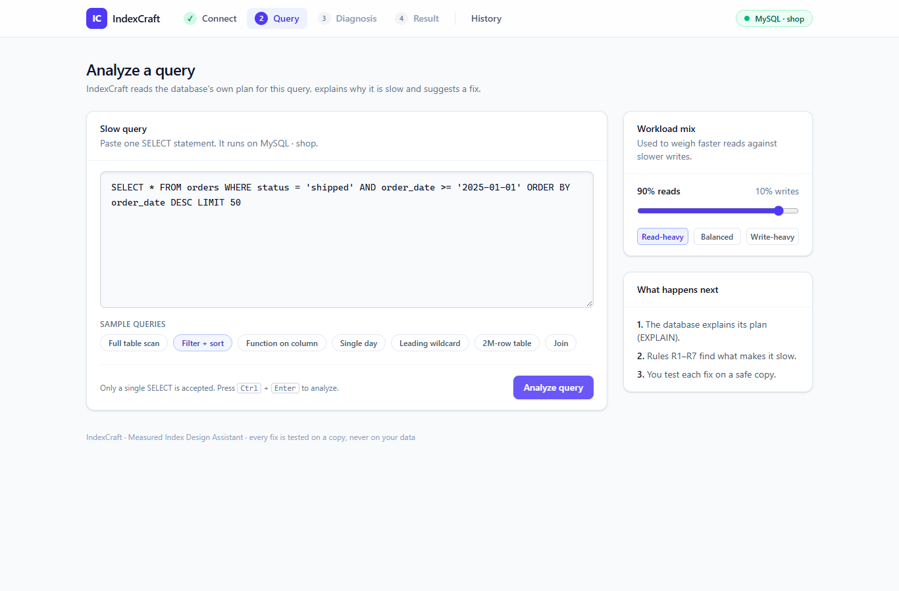
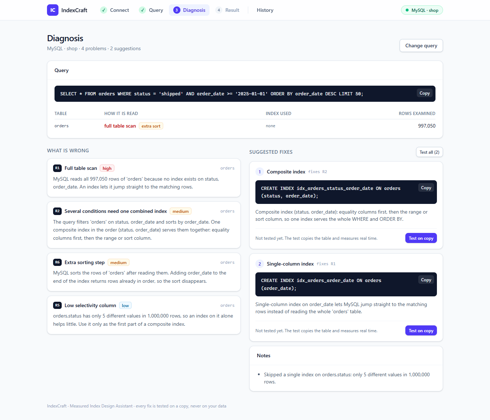
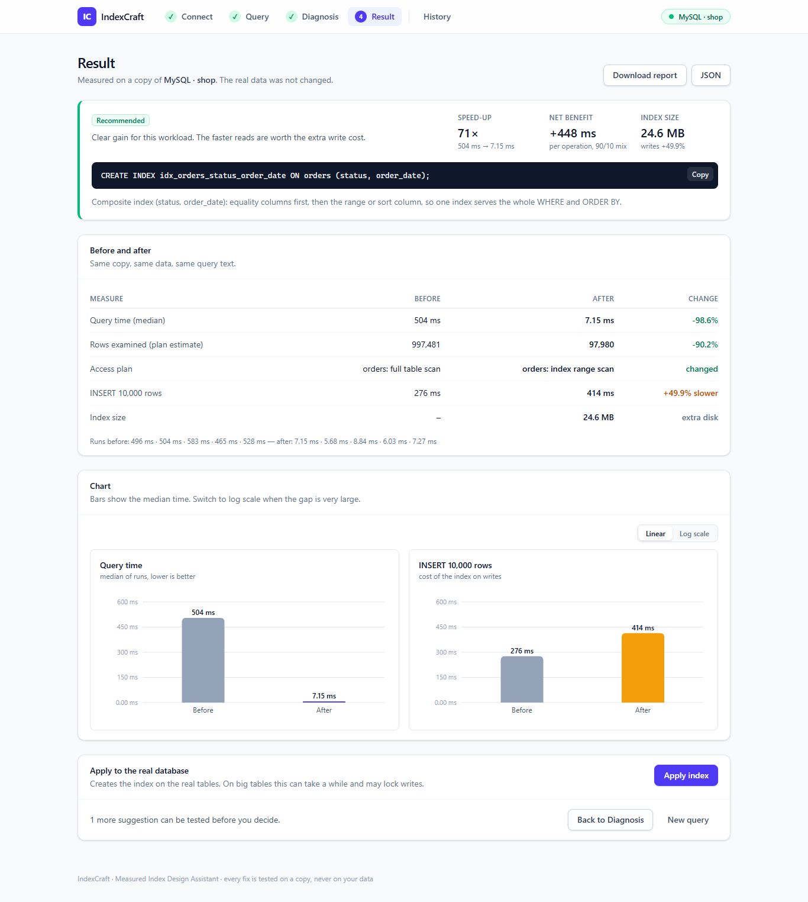
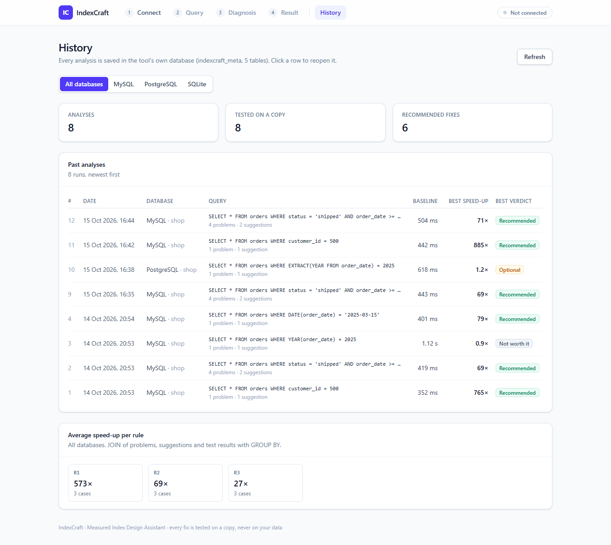

<div align="center">

# ⚡ IndexCraft

### Measured Index Design Assistant

**Find slow queries. Suggest the fix. Prove it with real numbers.**


</div>

---

## 📌 The Problem

When a table grows to millions of rows, queries that were fast during development suddenly take **seconds**. The database has no quick way to find the rows it needs, so it reads the whole table row by row.

> Imagine a library with 1,000,000 books and no catalogue. To find books by one author, the librarian must open every single book. **An index is that catalogue.**

Most developers guess which index to add. A wrong guess wastes disk space and slows down every `INSERT`.

## 💡 The Solution

IndexCraft studies a slow query, finds **why** it is slow, suggests the right index, and **proves** the fix by testing it on a safe copy of the data.

| Step | What happens |
|:---:|---|
| 🔍 **Analyze** | Reads the database's own plan (`EXPLAIN`) |
| 🩺 **Diagnose** | Explains the problem in plain English |
| 🛠️ **Design** | Suggests an index or rewrite with exact SQL |
| 🧪 **Prove** | Tests the fix on a clone and measures real time |
| ⚖️ **Balance** | Measures the write cost and index size |
| 📋 **Report** | Gives a clear verdict: Recommended or Not worth it |
| 🗂️ **Remember** | Saves every analysis in its own history database |

## 📊 Example Result

> `SELECT * FROM orders WHERE customer_id = 500;`

```sql
CREATE INDEX idx_orders_customer ON orders (customer_id);
```

| Measure | Before | After | Change |
|---|---:|---:|---|
| Query time (median) | 4.2 s | 0.02 s | 🚀 ~200x faster |
| Rows examined | 1,000,000 | 10 | -99.999% |
| INSERT 10,000 rows | 1.00x | 1.08x | 8% slower |
| Index size | – | 21 MB | extra disk |

**Verdict: ✅ Recommended** (read-heavy workload)

<sub>Example numbers only. Real results depend on your machine.</sub>

## 🖥️ Screens

| Screen | What it does |
|---|---|
| **1. Connect** | Database type dropdown (MySQL / PostgreSQL / SQLite), connection details, tables with row counts |
| **2. Query** | SQL box, sample queries for the chosen database, read/write mix slider |
| **3. Diagnosis** | Plan summary, problem cards (R1–R7), suggestion cards with exact SQL and a **Test on copy** button |
| **4. Result** | Verdict, before/after table, bar charts (linear or log scale), **Apply** with confirmation, report download |
| **5. History** | Past analyses from `indexcraft_meta`, filter by database, average speed-up per rule, run detail and delete |

<table>
<tr>
<td></td>
<td></td>
</tr>
<tr>
<td></td>
<td></td>
</tr>
</table>

<sub>Screenshots from the MySQL `shop` database with 1,000,000 orders.</sub>

## 🏗️ Architecture

```
 ┌──────────────────┐   HTTP / JSON   ┌───────────────────────┐
 │ Next.js Frontend │ ◄─────────────► │ FastAPI Backend       │
 └──────────────────┘                 └───────────┬───────────┘
                                                  │
                                      ┌───────────▼───────────┐
                                      │      CORE ENGINE      │──► History DB
                                      │ parser · rules        │   (5 tables)
                                      │ suggester · benchmark │
                                      │ write-cost · report   │
                                      └───────────┬───────────┘
                                                  │
                                      ┌───────────▼───────────┐
                                      │   ADAPTER INTERFACE   │
                                      └──┬────────┬────────┬──┘
                                         │        │        │
                                       MySQL  PostgreSQL SQLite
```

The core engine never talks to a database directly. Each database has a small **adapter**, so adding a new database means writing one new file.

## 🗄️ Database Design (10 Tables)

<table>
<tr>
<th>🛒 <code>shop</code> — test data</th>
<th>📚 <code>indexcraft_meta</code> — tool history</th>
</tr>
<tr>
<td>

| Table | Rows |
|---|---:|
| customers | 100,000 |
| categories | 50 |
| products | 1,000 |
| orders | 1,000,000 |
| order_items | 2,000,000 |

</td>
<td>

| Table | Stores |
|---|---|
| analysis_runs | each analyzed query |
| problems | detected issues (R1–R7) |
| suggestions | CREATE INDEX + reason |
| test_results | before/after numbers |
| reports | final report text |

</td>
</tr>
</table>

`shop` is **intentionally unindexed** to create slow queries. `indexcraft_meta` is a **properly designed** schema with primary keys, foreign keys, `ON DELETE CASCADE` and one-to-one relations.

## 🧠 Detection Rules

| Rule | Detects | Suggests |
|:---:|---|---|
| R1 | Full table scan | Index on filtered / joined columns |
| R2 | Several filters + range + ORDER BY | Composite index in the right order |
| R3 | Function on column (`YEAR(date)`) | Rewrite as a plain range |
| R4 | Leading wildcard (`LIKE '%ali'`) | Warn: normal index cannot help |
| R5 | Low selectivity column | Combine with another column or skip |
| R6 | Extra sorting (filesort) | Add ORDER BY columns to the index |
| R7 | Redundant index | Drop the shorter duplicate |

## 🚀 Getting Started

### Prerequisites
Python 3.10+ · Node.js LTS · MySQL 8 · PostgreSQL 16+ (optional) · Git

SQLite needs no server. It is built into Python.

### 1. Clone
```bash
git clone https://github.com/huzaifaakhtar7/indexcraft.git
cd indexcraft
```

### 2. Create the history database
Run this file once in MySQL Workbench:
```
backend/data/schema_meta.sql
```

### 3. Backend + test data
```bash
cd backend
python -m venv venv
venv\Scripts\activate
pip install -r requirements.txt
set DB_PASSWORD=your_mysql_password
set PG_PASSWORD=your_postgres_password
python data\generate_data.py --db all
uvicorn main:app --reload
```
API docs → http://localhost:8000/docs

The loader creates the `shop` tables and fills them with the same data (fixed random seed) in every database:

| Option | Meaning |
|---|---|
| `--db mysql` | MySQL only (default) |
| `--db postgres sqlite` | any mix of `mysql`, `postgres`, `sqlite` |
| `--db all` | all three databases |
| `--scale 0.1` | 100,000 orders instead of 1,000,000 (for slow machines) |

| Database | Where the data goes | Settings |
|---|---|---|
| MySQL | database `shop` | `DB_HOST`, `DB_USER`, `DB_PASSWORD` |
| PostgreSQL | database `shop` (created if missing) | `PG_HOST`, `PG_PORT`, `PG_USER`, `PG_PASSWORD` |
| SQLite | file `backend/data/shop.db` | `--sqlite-path` |

To run the sample queries on all three databases and test the best fix on a copy: `python check_part2.py`

### 4. Frontend
```bash
cd frontend
npm install
npm run dev
```
App → http://localhost:3000

The app talks to `http://localhost:8000/api` by default. To change it, copy `frontend/.env.local.example` to `frontend/.env.local` and edit `NEXT_PUBLIC_API_URL`.

## 🔌 API

All endpoints are under `/api`. Try them from Swagger at http://localhost:8000/docs.

| Method | Endpoint | Input | Output |
|---|---|---|---|
| POST | `/connect` | `db_type` (`mysql` / `postgres` / `sqlite`), host, port, user, password, database | `session_id`, tables and row counts |
| POST | `/analyze` | `session_id`, `query` | `run_id`, plan, problems, suggestions (with ids), notes |
| POST | `/test` | `session_id`, `suggestion_id`, `read_share`, `runs` | before/after time, rows examined, insert cost, index size, verdict |
| POST | `/apply` | `session_id`, `suggestion_id`, `confirm: true` | the SQL that was run on the real database |
| POST | `/disconnect` | `session_id` | closes the connection and deletes the test copy |
| GET | `/report/{report_id}?format=text` | report id | plain-English report (`json` or `text`) |
| GET | `/history?db_type=` | optional filter | past analyses with the best verdict |
| GET | `/history/{run_id}` | run id | problems, suggestions, test results and report |
| GET | `/history/stats` | – | average speed-up per rule, recent tests |
| DELETE | `/history/{run_id}` | run id | deletes the run and its linked rows (cascade) |
| GET | `/health` | – | backend status |

For SQLite, `database` is the `.db` file path (`shop.db` is found in `backend/data`). The history database is set with `META_DB_HOST`, `META_DB_USER` and `META_DB_PASSWORD`, or falls back to `DB_HOST`, `DB_USER` and `DB_PASSWORD`. Passwords stay in memory only, and validation errors never echo them back.

## 📁 Project Structure

```
indexcraft/
├── backend/
│   ├── main.py
│   ├── api/          routes, schemas, sessions
│   ├── core/         parser, rules, suggester, benchmark, scoring, reporter
│   ├── adapters/     base, mysql, postgres, sqlite, factory
│   ├── history/      saves runs into indexcraft_meta
│   ├── data/         schemas (MySQL, PostgreSQL, SQLite), data loader, sample queries
│   └── tests/
├── frontend/
│   ├── app/          connect, analyze, diagnosis, result, history, history/[runId]
│   ├── components/
│   └── lib/api.ts
└── docs/
```

## 🗺️ Roadmap

- [x] Project setup and folder structure
- [x] 10-table database design
- [x] Test data generator (1,000,000 orders)
- [x] MySQL adapter and timing engine
- [x] EXPLAIN reader and rule engine
- [x] Index suggestion engine
- [x] Clone and test
- [x] Write-cost measurement and ranking
- [x] History database layer
- [x] FastAPI endpoints
- [x] Next.js screens
- [x] PostgreSQL and SQLite adapters

## 🛡️ Safety

- Every fix is tested on a **clone**, never on the real data
- Only single `SELECT` statements are accepted
- Passwords stay in memory and are **never** saved to disk or history
- Changes to the real database need explicit confirmation

## 👨‍💻 Author

**Huzaifa Akhtar** · [@huzaifaakhtar7](https://github.com/huzaifaakhtar7)

<div align="center">

⭐ If you find this project useful, give it a star!

</div>
